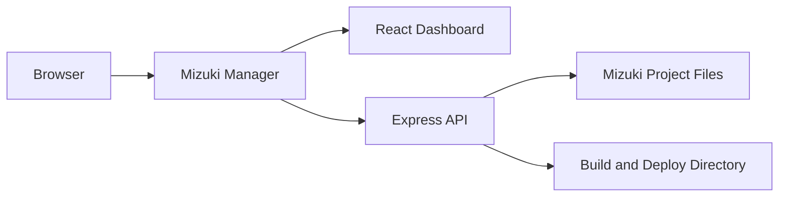

<div align="center">
  <a href="./README.md">简体中文</a> · <strong>English</strong>
</div>

<br />

<div align="center">
  
  <h1>Mizuki Manager</h1>
  <p>A visual content management, build, and deployment tool for the <a href="https://github.com/LyraVoid/Mizuki">Mizuki</a> static blog.</p>

  <p>
    
    
    
    
    
    
  </p>
</div>

## Overview

Mizuki Manager works directly with the files of a Mizuki project on your server. It provides a unified administration interface for users who prefer not to edit configuration, Markdown, and data files manually. The project includes a React dashboard, an Express API, authentication, production builds, and process management.

For the simplest deployment, run Mizuki Manager on the same server as the Mizuki blog and point `BASE_PATH` to the blog's project directory.

## Features

- **Content management** for posts, the About page, albums, anime, devices, diaries, friends, music, projects, skills, and timeline entries.
- **Markdown editing** with a toolbar, live preview, and local draft persistence for posts and the About page.
- **Visual configuration** for common Mizuki settings without editing source files by hand.
- **Asset management** for images, audio, and other static blog resources.
- **Build and deployment** controls with real-time build logs.
- **Authentication** using JWTs, refresh-token cookies, CAPTCHA, and single-session control.
- **Responsive UI** built with React, Tailwind CSS, and Radix UI for desktop and mobile use.

## How It Works



In development, the frontend runs on port `3000` and the API runs on port `3001` by default. In production, Express serves both the API and the compiled frontend from the port configured by `PORT`.

## Tech Stack

| Layer | Technologies |
| --- | --- |
| Frontend | React 19, TypeScript, React Router, Tailwind CSS 4, Radix UI |
| Markdown | `@uiw/react-md-editor` |
| Build | Webpack 5, esbuild-loader, PostCSS |
| Backend | Node.js, Express 5 |
| Authentication | JSON Web Token, HTTP cookies, SVG Captcha |
| Process management | PM2, Nodemon |
| File transformation | Recast, Babel Parser |

## Quick Start

### 1. Clone the Repository

```bash
git clone https://github.com/2126340634/Mizuki-Manager.git
cd Mizuki-Manager
```

### 2. Install Dependencies

```bash
pnpm install
pnpm --dir frontend install
```

The current tested environment uses Node.js `25.5.0` and pnpm `12.x`. A recent Node.js release is recommended.

### 3. Configure Environment Variables

Copy the environment template:

```bash
cp .env.example .env
```

On Windows PowerShell:

```powershell
Copy-Item .env.example .env
```

Then edit `.env`. Set `MIZUKI_USERNAME`, `MIZUKI_PASSWORD`, `JWT_SECRET`, `BASE_PATH`, and `DEPLOY_DIR` for your environment.

### 4. Start Development

```bash
pnpm dev
```

This starts both the Webpack development server and the Express API:

- Dashboard: <http://localhost:3000>
- API: <http://localhost:3001>

## Environment Variables

| Variable | Description | Example / Default |
| --- | --- | --- |
| `MIZUKI_USERNAME` | Dashboard login username | Required |
| `MIZUKI_PASSWORD` | Dashboard login password | Required |
| `JWT_SECRET` | JWT signing secret; use a strong random value in production | Required |
| `BASE_PATH` | Root directory of the Mizuki project | `C:/Projects/Mizuki` |
| `DEPLOY_DIR` | Deployment directory for the Mizuki build output | `C:/Projects/Mizuki/dist` |
| `PORT` | API and production dashboard port | `3001` |
| `FRONTEND_DEV_PORT` | Frontend development port | `3000` |
| `DB_VERSION` | Browser IndexedDB version | `1` |
| `PACKAGE_TOOL` | Package manager: `pnpm`, `npm`, or `yarn` | `pnpm` |
| `TOKEN_EXPIRES_IN` | Login token lifetime | `7d` |
| `COOKIE_SECURE` | Send the refresh-token cookie over HTTPS only | `true` |
| `ICONIFY_URL` | Iconify website URL | `https://icon-sets.iconify.design` |

## Commands

| Command | Description |
| --- | --- |
| `pnpm dev` | Start the frontend and backend development services |
| `pnpm start` | Build the frontend and start production with PM2 |
| `pnpm log` | View PM2 service logs |
| `pnpm stop` | Stop the PM2 service |
| `pnpm --dir frontend build` | Build only the frontend |

## Production Deployment

```bash
pnpm start
```

The startup script will:

1. Check and install root and frontend dependencies;
2. Build the production frontend;
3. Start the Express service with PM2;
4. Serve the dashboard and API from the port configured by `PORT`.

Use an HTTPS reverse proxy in production and keep `COOKIE_SECURE=true`. Set it to `false` only in a controlled environment where plain HTTP is explicitly required.

## Project Structure

```text
Mizuki-Manager/
├─ frontend/          # React dashboard and Webpack configuration
├─ server/            # Express API, routes, middleware, and managers
├─ .env.example       # Environment variable template
├─ start.js           # Development and production entry point
└─ package.json       # Root commands and backend dependencies
```

## Troubleshooting

### `.env file does not exist`

Copy `.env.example` to `.env` and provide all required values.

### The development port is already in use

Change `FRONTEND_DEV_PORT` or `PORT` in `.env`, or stop the process currently using that port.

### Requests fail after login

Make sure `BASE_PATH` points to a valid Mizuki project and that the current user has read and write access to it.

## Related Projects

- [Mizuki](https://github.com/LyraVoid/Mizuki) — the static blog managed by this project.
- [Mizuki Manager Issues](https://github.com/2126340634/Mizuki-Manager/issues) — bug reports and feature requests.

## License

The project declares the ISC License in `package.json`.
