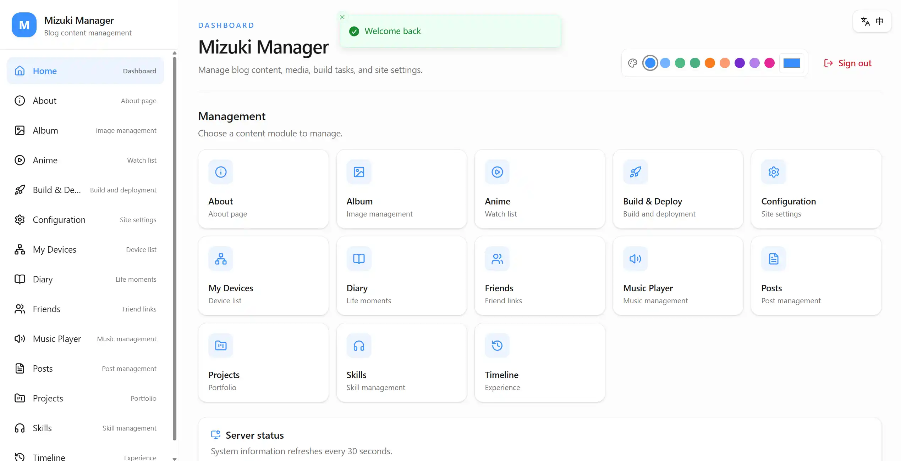
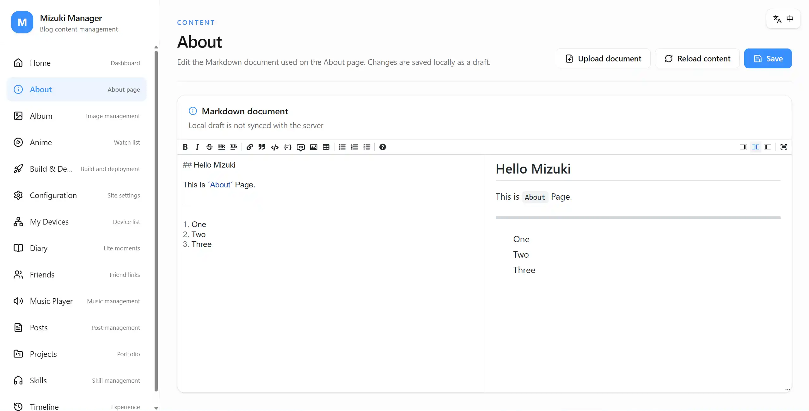
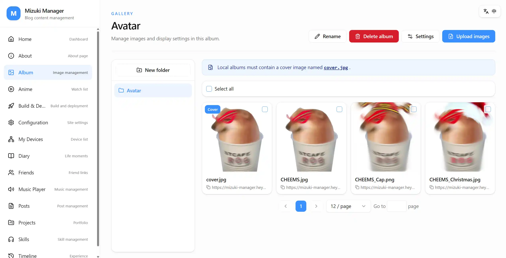
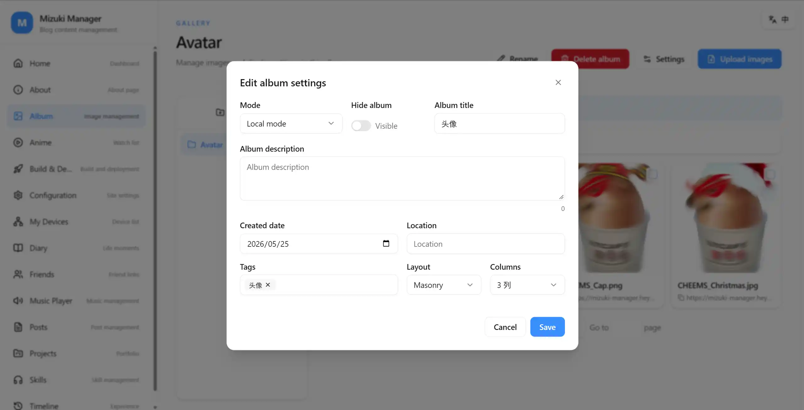
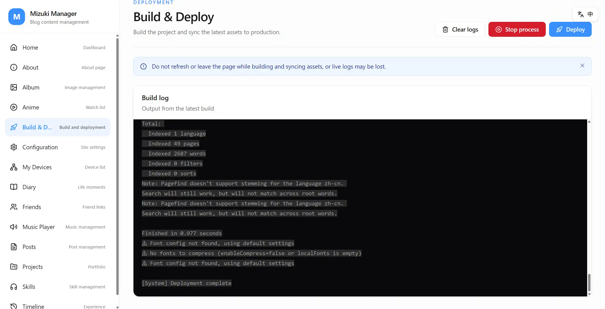
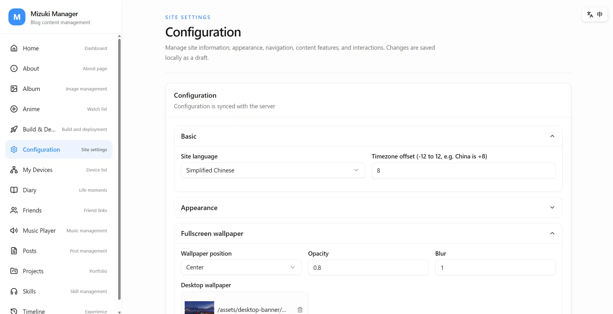
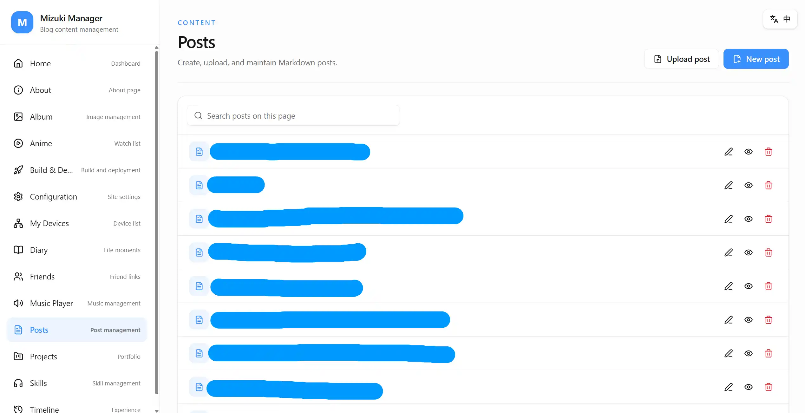
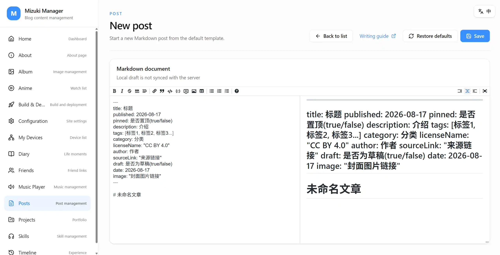

<div align="center">
  <strong>简体中文</strong> · <a href="./README.en.md">English</a>
</div>

<br />

<div align="center">
  
  <h1>Mizuki Manager</h1>
  <p>面向 <a href="https://github.com/LyraVoid/Mizuki">Mizuki</a> 静态博客的可视化内容管理与构建部署工具。</p>

  <p>
    
    
    
    
    
    
  </p>
</div>

## 项目简介

Mizuki Manager 直接管理服务器上的 Mizuki 项目文件，为不希望频繁手动编辑配置、Markdown 和数据文件的用户提供统一后台。它同时包含 React 管理界面、Express API、身份认证以及生产环境构建与进程管理能力。

推荐将 Manager 与 Mizuki 博客部署在同一台服务器上，并通过 `BASE_PATH` 指向博客项目根目录。

## 功能特性

- **内容管理**：维护文章、关于页、相册、追番、设备、日记、友链、音乐、项目、技能和时间线数据。
- **Markdown 编辑**：文章和关于页支持工具栏、实时预览与本地草稿缓存。
- **配置管理**：通过表单可视化编辑 Mizuki 配置，减少直接修改源码的成本。
- **资源管理**：上传和管理博客使用的图片、音频及其他静态资源。
- **构建部署**：在后台触发生产构建与部署，并查看实时构建日志。
- **身份认证**：使用 JWT、刷新令牌 Cookie、验证码和单会话控制保护管理入口。
- **响应式界面**：前端基于 React 19、TypeScript、React Router、Tailwind CSS 4、shadcn/ui 与 Radix UI，适配桌面和移动设备。
- **多语言支持**：内置简体中文和英文界面，可随时切换显示语言。

## 界面预览

<table>
  <tr>
    <td align="center" width="50%">
      <br />
      <sub>登录界面</sub>
    </td>
    <td align="center" width="50%">
      <br />
      <sub>管理首页</sub>
    </td>
  </tr>
  <tr>
    <td align="center" width="50%">
      <br />
      <sub>关于页面</sub>
    </td>
    <td align="center" width="50%">
      <br />
      <sub>相册管理</sub>
    </td>
  </tr>
  <tr>
    <td align="center" width="50%">
      <br />
      <sub>相册设置</sub>
    </td>
    <td align="center" width="50%">
      <br />
      <sub>构建部署</sub>
    </td>
  </tr>
  <tr>
    <td align="center" width="50%">
      <br />
      <sub>配置管理</sub>
    </td>
    <td align="center" width="50%">
      <br />
      <sub>文章管理</sub>
    </td>
  </tr>
  <tr>
    <td align="center" colspan="2">
      <br />
      <sub>Markdown 编辑器</sub>
    </td>
  </tr>
</table>

## 工作方式

```text
浏览器
  │
  ▼
Mizuki Manager
  ├─ React 管理界面
  └─ Express API
      ├─ 读写 Mizuki 项目文件
      └─ 构建并同步部署目录
```

开发环境中，前端默认运行于 `3000` 端口，API 默认运行于 `3001` 端口；生产环境由 Express 在 `PORT` 指定的端口同时提供 API 和前端构建产物。

## 技术栈

| 层级 | 技术 |
| --- | --- |
| 前端 | React 19、TypeScript、React Router、Tailwind CSS 4、shadcn/ui、Radix UI |
| Markdown | `@uiw/react-md-editor` |
| 构建 | Webpack 5、esbuild-loader、PostCSS |
| 服务端 | Node.js、Express 5 |
| 认证 | JSON Web Token、HTTP Cookie、SVG Captcha |
| 进程管理 | PM2、Nodemon |
| 文件修改 | Recast、Babel Parser |

## 快速开始

### 1. 获取项目

```bash
git clone https://github.com/2126340634/Mizuki-Manager.git
cd Mizuki-Manager
```

### 2. 安装依赖

```bash
pnpm install
pnpm --dir frontend install
```

当前测试环境为 Node.js `25.5.0` 与 pnpm `12.x`。建议使用较新的 Node.js 版本。

### 3. 配置环境变量

复制配置模板：

```bash
cp .env.example .env
```

Windows PowerShell：

```powershell
Copy-Item .env.example .env
```

然后填写 `.env`。其中 `MIZUKI_USERNAME`、`MIZUKI_PASSWORD`、`JWT_SECRET`、`BASE_PATH` 和 `DEPLOY_DIR` 必须按实际环境配置。

### 4. 启动开发环境

```bash
pnpm dev
```

该命令会同时启动 Webpack 开发服务器和 Express API：

- 管理界面：<http://localhost:3000>
- API 服务：<http://localhost:3001>

## 环境变量

| 变量 | 说明 | 示例/默认值 |
| --- | --- | --- |
| `MIZUKI_USERNAME` | 管理后台登录账号 | 必填 |
| `MIZUKI_PASSWORD` | 管理后台登录密码 | 必填 |
| `JWT_SECRET` | JWT 签名密钥，生产环境请使用高强度随机值 | 必填 |
| `BASE_PATH` | Mizuki 项目根目录 | `C:/Projects/Mizuki` |
| `DEPLOY_DIR` | Mizuki 构建产物部署目录 | `C:/Projects/Mizuki/dist` |
| `PORT` | API 与生产环境访问端口 | `3001` |
| `FRONTEND_DEV_PORT` | 开发环境前端端口 | `3000` |
| `DB_VERSION` | 浏览器 IndexedDB 版本 | `1` |
| `PACKAGE_TOOL` | 包管理器，可选 `pnpm`、`npm`、`yarn` | `pnpm` |
| `TOKEN_EXPIRES_IN` | 登录令牌有效期 | `7d` |
| `COOKIE_SECURE` | 是否仅通过 HTTPS 发送刷新令牌 Cookie | `true` |
| `ICONIFY_URL` | Iconify 图标站点地址 | `https://icon-sets.iconify.design` |

## 常用命令

| 命令 | 说明 |
| --- | --- |
| `pnpm dev` | 启动前端与服务端开发环境 |
| `pnpm start` | 构建前端并通过 PM2 启动生产服务 |
| `pnpm log` | 查看 PM2 服务日志 |
| `pnpm stop` | 停止 PM2 服务 |
| `pnpm --dir frontend build` | 仅构建前端 |

## 生产部署

```bash
pnpm start
```

启动脚本会：

1. 检查并安装根目录与前端依赖；
2. 构建前端生产资源；
3. 使用 PM2 启动 Express 服务；
4. 通过 `PORT` 指定的端口提供管理界面和 API。

建议在生产环境前配置 HTTPS 反向代理，并保持 `COOKIE_SECURE=true`。只有在明确使用普通 HTTP 的受控环境中才应将其设为 `false`。

## 项目结构

```text
Mizuki-Manager/
├─ frontend/          # React 管理界面与 Webpack 配置
├─ server/            # Express API、路由、中间件和管理器
├─ .env.example       # 环境变量模板
├─ start.js           # 开发与生产启动入口
└─ package.json       # 根目录命令与服务端依赖
```

## 常见问题

### 提示 `.env 文件不存在`

请将 `.env.example` 复制为 `.env`，并填写所有必需配置。

### 开发服务提示端口已被占用

修改 `.env` 中的 `FRONTEND_DEV_PORT` 或 `PORT`，或者先停止占用对应端口的进程。

### 登录后请求失败

检查 `BASE_PATH` 是否指向有效的 Mizuki 项目目录，并确认当前用户拥有该目录的读写权限。

## 相关项目

- [Mizuki](https://github.com/LyraVoid/Mizuki) — 本项目所管理的静态博客。

## 许可证

项目在 `package.json` 中声明使用 ISC License。
